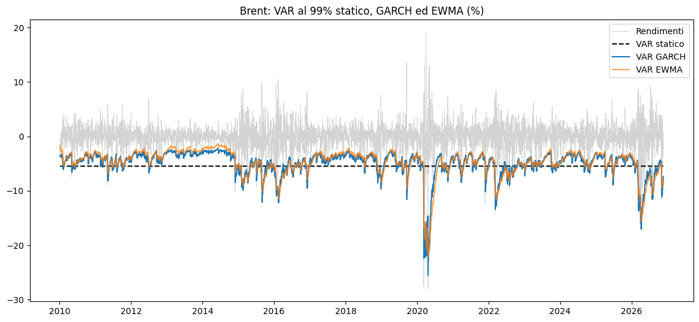

# Python Projects

Progetti di **risk management e finanza quantitativa in Python**: analisi di serie storiche finanziarie, modelli econometrici e misure di rischio applicate a dati di mercato reali.

Ogni progetto si trova in una cartella separata, con il proprio README, il notebook dell'analisi, il codice e i grafici dei risultati.

---

## Progetti

### [Risk management sul petrolio Brent: ARMA, GARCH e VaR dinamico](brent-arma-garch-var/)
*Progetto del corso Python for Risk*

Analisi di oltre 4.200 osservazioni giornaliere del future sul Brent (2010-2026):
- test di stazionarietà;
- selezione di modelli ARMA con AIC e BIC;
- stima di un GARCH(1,1) per la volatilità;
- backtest di tre VaR al 99% (statico, EWMA e GARCH).

**Risultato chiave:** il VaR dinamico GARCH distribuisce le violazioni in modo uniforme nel tempo (6 contro 16 del VaR statico nel 2020) e non entra mai nella zona rossa del sistema a semaforo di Basilea.

`pandas` · `statsmodels` · `arch` · `SciPy` · `Matplotlib` · `yfinance`

[](brent-arma-garch-var/)

---

## Competenze

| Area | Strumenti e metodi |
|---|---|
| Serie storiche | stazionarietà (ADF, KPSS), ACF/PACF, Ljung-Box, modelli ARMA |
| Volatilità | GARCH, EWMA, volatility clustering |
| Misure di rischio | Value at Risk statico e dinamico, backtest delle violazioni |
| Python | pandas, NumPy, statsmodels, arch, SciPy, Matplotlib |

---

## Struttura di ogni progetto

```
nome-progetto/
├── README.md          # obiettivi, risultati e istruzioni
├── requirements.txt   # librerie necessarie
├── main.py            # esecuzione completa da terminale
├── utils/             # funzioni riutilizzabili
├── notebooks/         # analisi commentata passo per passo
├── data/              # dati (scaricati in automatico)
└── reports/figures/   # grafici dei risultati
```

---

*I dati utilizzati provengono da fonti pubbliche e sono usati a scopo didattico. I contenuti non costituiscono consulenza finanziaria.*
