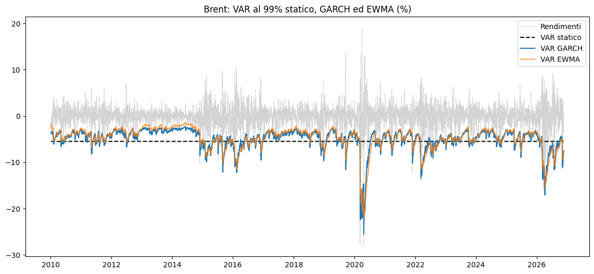
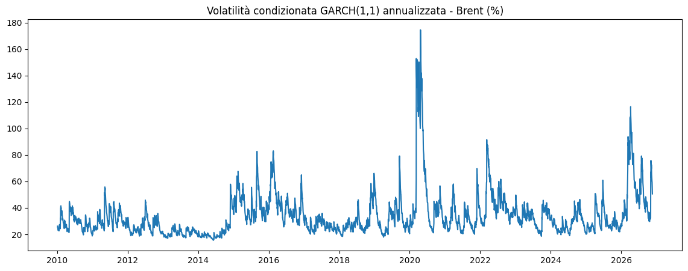
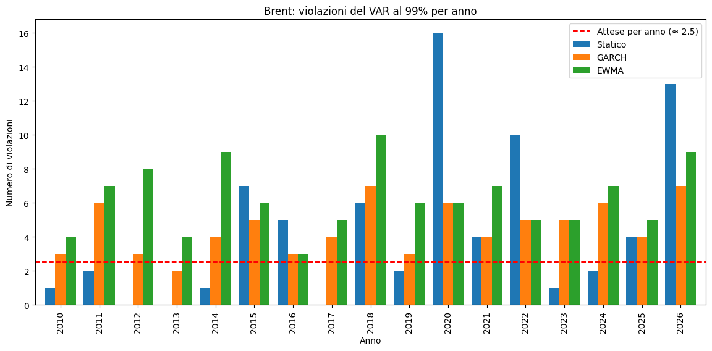

# ARMA, GARCH e VAR dinamico sul petrolio Brent

Analisi econometrica del rischio sul petrolio Brent (future `BZ=F`, dati giornalieri dal 2010 a oggi). Il progetto segue la procedura completa: verifica della stazionarietà, studio dell'autocorrelazione, stima di un modello ARMA per la media e di un GARCH(1,1) per la volatilità. Infine costruisce un **Value at Risk dinamico al 99%** e lo confronta con il VAR statico e con il VAR EWMA tramite backtest delle violazioni.

Progetto realizzato per il corso *Python for Risk*.



---

## Domande di ricerca

1. Il petrolio Brent è stazionario?
2. C'è autocorrelazione nella media e nella varianza dei rendimenti? Quali modelli suggeriscono i dati?
3. Qual è il modello ARMA ottimale? I coefficienti sono significativi? Il modello è adeguato?
4. Come si interpretano i parametri di un GARCH(1,1)? Il modello è adeguato?
5. Quale VAR al 99% (statico, GARCH, EWMA) produce meno violazioni?
6. Perché un Risk Manager dovrebbe preferire il VAR dinamico per il Brent?

---

## Risultati principali

### 1. Stazionarietà
| Serie | ADF p-value | Conclusione |
|---|---|---|
| Prezzi | 0.196 | non stazionari (radice unitaria) |
| Rendimenti logaritmici | ≈ 0 | stazionari, confermato dal KPSS (p ≥ 0.10) |

### 2. Autocorrelazione
- **Media:** autocorrelazione debole, concentrata al lag 4.
- **Varianza:** autocorrelazione fortissima nei rendimenti al quadrato (Ljung-Box con p-value fino a 10⁻¹⁶⁴). È il *volatility clustering*, che indica la necessità di un modello GARCH.

### 3. ARMA
- **Scelta del modello:** l'AIC seleziona un ARMA(3,2), il BIC un ARMA(0,0). L'ARMA(3,2) è l'unico che elimina l'autocorrelazione dei residui fino al lag 10, ma è sovraparametrizzato: le radici AR e MA quasi si annullano.
- **Residui:** in entrambi i modelli sono eteroschedastici e fortemente non normali (asimmetria ≈ −0.96, curtosi ≈ 17).

### 4. GARCH(1,1)
| Parametro | Stima | Interpretazione |
|---|---|---|
| ω | 0.091 | componente costante della varianza |
| α | 0.104 | effetto shock: reazione rapida alle notizie |
| β | 0.884 | effetto persistenza |
| α + β | 0.988 | persistenza elevata ma < 1: stazionario in varianza |
| Volatilità di lungo periodo | ≈ 43% annua | livello verso cui la volatilità ritorna |
| Half-life di uno shock | ≈ 56 giorni | tempo di dimezzamento dell'effetto di uno shock |

**Diagnostica:** i residui standardizzati non mostrano autocorrelazione né nei livelli né nei quadrati (Ljung-Box p > 0.07, test ARCH p = 0.64). Il modello è adeguato.



### 5. Backtest del VAR al 99%
4.214 giorni analizzati, circa 42 violazioni attese (1%).

| VAR | Violazioni | % |
|---|---|---|
| Statico | 74 | 1.76% |
| GARCH | 77 | 1.83% |
| EWMA | 106 | 2.52% |

Il VAR statico ha il totale più basso, ma la differenza con il GARCH non è statisticamente rilevante. Le violazioni dello statico sono **concentrate nelle crisi** (16 nel 2020, 10 nel 2022, 13 nel 2026) e **assenti negli anni calmi** (2012, 2013, 2017). Il VAR GARCH distribuisce le violazioni in modo uniforme e non raggiunge mai la zona rossa del sistema a semaforo di Basilea.



### 6. Conclusione
Il VAR dinamico GARCH è lo strumento più adatto al Brent:
- segue la volatilità effettiva del mercato;
- protegge nelle crisi;
- non immobilizza capitale nei periodi calmi.

Tutti i modelli superano però le violazioni attese perché usano il quantile della normale su rendimenti con code molto pesanti.

---

## Struttura del repository

```
brent-arma-garch-var/
├── README.md
├── requirements.txt
├── .gitignore
├── main.py                       # esegue l'intera analisi da terminale
├── utils/
│   ├── __init__.py
│   └── helper.py                 # funzioni: dati, test, ARMA, GARCH, VAR
├── notebooks/
│   └── Progetto_1_Brent.ipynb    # analisi completa con commenti e grafici
├── data/
│   └── README.md                 # i dati si scaricano con main.py
└── reports/
    └── figures/                  # grafici dell'analisi
```

---

## Come eseguire il progetto

### Opzione 1: notebook
Apri `notebooks/Progetto_1_Brent.ipynb` in Jupyter o Google Colab ed esegui tutte le celle.

### Opzione 2: script
```bash
git clone <url-del-repository>
cd brent-arma-garch-var
python -m venv venv
source venv/bin/activate          # su Windows: venv\Scripts\activate
pip install -r requirements.txt
python main.py
```

Lo script scarica i dati aggiornati e stampa i risultati di ogni punto. Salva le tabelle in `reports/` e i grafici in `reports/figures/`. Per rieseguirlo senza scaricare di nuovo i dati: `python main.py --offline`.

**Nota:** i dati si aggiornano ogni giorno, quindi eseguendo l'analisi in una data diversa i numeri possono differire leggermente da quelli riportati sopra (calcolati a novembre 2026).

---

## Metodologia

| Passaggio | Strumento |
|---|---|
| Stazionarietà | Augmented Dickey-Fuller, KPSS, ACF/PACF |
| Autocorrelazione | Ljung-Box su rendimenti e rendimenti al quadrato |
| Eteroschedasticità | Test ARCH di Engle |
| Media condizionata | ARMA(p,q), selezione con AIC e BIC |
| Varianza condizionata | GARCH(1,1) con distribuzione normale |
| Rischio | VAR al 99%: VARₜ = μ + z₀.₀₁ · σₜ |
| Backtest | Conteggio delle violazioni, totale e per anno |

## Limiti
- **Analisi in-sample:** i parametri del GARCH e la volatilità statica sono stimati sull'intero campione. Un backtest out-of-sample ristimerebbe i modelli usando solo i dati passati.
- **Quantile normale:** sottostima le perdite estreme di un asset con code pesanti. Una distribuzione t di Student migliorerebbe la calibrazione del VAR.
- **Future continuo:** `BZ=F` cambia contratto alla scadenza (roll), il che può generare piccoli salti nei rendimenti.

## Tecnologie
Python · pandas · NumPy · statsmodels · arch · SciPy · Matplotlib · yfinance

---

*I dati provengono da Yahoo Finance e sono usati a scopo didattico. Il progetto non costituisce consulenza finanziaria.*
